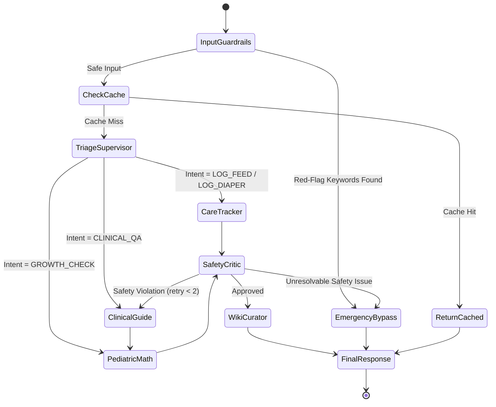

# Complete Python Backend Architecture Blueprint

> [!IMPORTANT]
> This is the definitive architecture reference. Read it fully before writing any code. Every file, endpoint, model, service, and agent node is specified here.

---

## 1. Final Backend Directory Structure

Every file listed below will be created during implementation. Nothing is optional.

```
nicu_care_backend/
│
├── app/
│   ├── __init__.py
│   ├── main.py                         # FastAPI app, CORS, route registration
│   ├── config.py                       # Environment settings & feature flags
│   │
│   ├── models/                         # Pydantic schemas (request/response contracts)
│   │   ├── __init__.py
│   │   ├── baby.py                     # BabyProfile, CorrectedAge, GrowthEntry
│   │   ├── care_log.py                 # FeedingEntry, DiaperEntry, MedicationEntry
│   │   ├── hospital.py                 # HospitalSearchRequest, HospitalEmergencyContact
│   │   ├── agent.py                    # VoiceQueryRequest, VoiceQueryResponse
│   │   └── wiki.py                     # WikiSection, WikiPatchRequest
│   │
│   ├── routers/                        # FastAPI route handlers (thin controllers)
│   │   ├── __init__.py
│   │   ├── hospitals.py                # GET  /api/v1/hospitals/search
│   │   ├── agent.py                    # POST /api/v1/agent/text-query
│   │   │                               # POST /api/v1/agent/voice-query
│   │   ├── baby.py                     # POST /api/v1/baby/register
│   │   │                               # GET  /api/v1/baby/{baby_id}/profile
│   │   │                               # GET  /api/v1/baby/{baby_id}/corrected-age
│   │   ├── care_logs.py                # POST /api/v1/baby/{baby_id}/feeds
│   │   │                               # POST /api/v1/baby/{baby_id}/diapers
│   │   │                               # GET  /api/v1/baby/{baby_id}/feeds/today
│   │   │                               # GET  /api/v1/baby/{baby_id}/summary/48h
│   │   └── wiki.py                     # GET  /api/v1/baby/{baby_id}/wiki/{section}
│   │                                   # PATCH /api/v1/baby/{baby_id}/wiki/{section}
│   │
│   ├── services/                       # Core business logic (pure Python, no HTTP)
│   │   ├── __init__.py
│   │   ├── hospital_service.py         # Google Places API + curated fallback DB
│   │   ├── pediatric_math_service.py   # Corrected age, Fenton percentiles, dosage checks
│   │   ├── wiki_service.py             # Read/write Baby Health Wiki (local files or Firestore)
│   │   ├── care_log_service.py         # Feed/diaper/medication CRUD + 48h rolling summary
│   │   ├── cache_service.py            # In-memory semantic cache (local Redis mock)
│   │   └── notification_service.py     # Medication reminder scheduler (local mock)
│   │
│   ├── agent/                          # LangGraph multi-agent orchestration
│   │   ├── __init__.py
│   │   ├── state.py                    # NICUAgentState TypedDict
│   │   ├── graph.py                    # LangGraph StateGraph definition & compilation
│   │   ├── nodes/
│   │   │   ├── __init__.py
│   │   │   ├── triage_supervisor.py    # Intent classification & urgency routing
│   │   │   ├── care_tracker.py         # Structured extraction → DB write
│   │   │   ├── clinical_guide.py       # RAG retrieval + Gemini synthesis
│   │   │   ├── pediatric_math.py       # Deterministic calculations (zero LLM)
│   │   │   ├── safety_critic.py        # Red-flag veto + tone enforcement
│   │   │   └── wiki_curator.py         # Async background wiki patcher
│   │   └── guardrails/
│   │       ├── __init__.py
│   │       ├── input_guardrails.py     # L1: Red-flag keyword scan, PHI masking
│   │       ├── retrieval_guardrails.py # L2: Relevance threshold, GA age filter
│   │       ├── tool_guardrails.py      # L3: Dosage bounds, volume sanity checks
│   │       └── output_guardrails.py    # L4: Faithfulness check, tone, disclaimer
│   │
│   └── knowledge/                      # RAG knowledge base (local files)
│       ├── guidelines/                 # Clinical guideline text chunks
│       │   ├── aap_preterm_feeding.md
│       │   ├── aap_safe_sleep.md
│       │   ├── who_kangaroo_care.md
│       │   └── nicu_discharge_faq.md
│       └── embeddings/                 # Pre-computed vectors (optional, Phase 3)
│           └── guideline_vectors.json
│
├── data/                               # Local persistent storage (emulates Firestore)
│   └── wiki/
│       └── baby_liam_01/
│           ├── profile.md
│           ├── active_regimen.md
│           ├── clinical_alerts.md
│           └── rolling_log_summary.md
│
├── tests/                              # Automated test suite
│   ├── __init__.py
│   ├── test_hospital_service.py
│   ├── test_pediatric_math.py
│   ├── test_care_logs.py
│   ├── test_guardrails.py
│   └── test_agent_graph.py
│
├── streamlit_app.py                    # Interactive Streamlit test harness
├── requirements.txt                    # Python dependencies
├── Dockerfile                          # Cloud Run container (Phase 6)
├── .env.example                        # Environment variable template
└── README.md                           # Setup & run instructions
```

---

## 2. Complete API Endpoint Contract

### 2.1 Hospital Emergency Service

| Method | Endpoint | Description | Request | Response |
| :--- | :--- | :--- | :--- | :--- |
| `GET` | `/api/v1/hospitals/search` | Fetches 24/7 emergency numbers by hospital name/location | `?query=BirthRight Rainbow Vijayawada` | `HospitalEmergencyContact` |

### 2.2 Baby Profile & Corrected Age

| Method | Endpoint | Description | Request | Response |
| :--- | :--- | :--- | :--- | :--- |
| `POST` | `/api/v1/baby/register` | Registers a new baby profile | `BabyProfile` JSON body | `BabyProfile` with ID |
| `GET` | `/api/v1/baby/{baby_id}/profile` | Returns baby's clinical profile | Path param | `BabyProfile` |
| `GET` | `/api/v1/baby/{baby_id}/corrected-age` | Calculates corrected gestational age | Path param | `CorrectedAge` |

### 2.3 Care Logging (Feeds, Diapers, Meds)

| Method | Endpoint | Description | Request | Response |
| :--- | :--- | :--- | :--- | :--- |
| `POST` | `/api/v1/baby/{baby_id}/feeds` | Logs a feeding entry | `FeedingEntry` JSON | `FeedingEntry` with timestamp |
| `POST` | `/api/v1/baby/{baby_id}/diapers` | Logs a diaper change | `DiaperEntry` JSON | `DiaperEntry` with timestamp |
| `GET` | `/api/v1/baby/{baby_id}/feeds/today` | Lists today's feeds | Path param | `List[FeedingEntry]` |
| `GET` | `/api/v1/baby/{baby_id}/summary/48h` | Generates a 48-hour care summary | Path param | `CareSummary` |

### 2.4 Baby Health Wiki (Living Memory)

| Method | Endpoint | Description | Request | Response |
| :--- | :--- | :--- | :--- | :--- |
| `GET` | `/api/v1/baby/{baby_id}/wiki/{section}` | Reads a wiki section | `section` = `profile`, `regimen`, `alerts`, `log` | `WikiSection` markdown |
| `PATCH` | `/api/v1/baby/{baby_id}/wiki/{section}` | Updates a wiki section | `WikiPatchRequest` JSON | `WikiSection` updated |

### 2.5 Agentic Voice & Text Processing

| Method | Endpoint | Description | Request | Response |
| :--- | :--- | :--- | :--- | :--- |
| `POST` | `/api/v1/agent/text-query` | Processes a text message through the LangGraph agent | `{"baby_id": "...", "text": "...", "lang": "en"}` | `VoiceQueryResponse` |
| `POST` | `/api/v1/agent/voice-query` | Processes uploaded audio through STT + agent | `multipart: audio file + baby_id` | `VoiceQueryResponse` |

---

## 3. Complete Pydantic Data Models

### 3.1 Baby Profile & Medical Identity

```python
# app/models/baby.py

class BabyProfile(BaseModel):
    baby_id: str                                # "baby_liam_01"
    name: str                                   # "Liam"
    date_of_birth: date                         # 2026-09-28
    gestational_age_weeks: int                  # 29 (born at 29 weeks)
    gestational_age_days: int                   # 2
    sex: Literal["male", "female"]
    birth_weight_grams: int                     # 1180
    discharge_weight_grams: int                 # 1820
    discharge_date: date                        # 2026-10-15
    discharge_hospital: str                     # "BirthRight Rainbow Vijayawada"
    pediatrician_name: Optional[str]            # "Dr. Rao"
    mother_preferred_language: str              # "en-US", "te-IN", "hi-IN"
    blood_type: Optional[str]                   # "O+"

class CorrectedAge(BaseModel):
    chronological_days: int
    chronological_weeks: int
    corrected_total_days: int
    corrected_weeks: int
    corrected_remaining_days: int
    weeks_born_early: int
    note: str                                   # "Evaluate milestones at 2w 3d, not 8w"
```

### 3.2 Care Logging

```python
# app/models/care_log.py

class FeedingEntry(BaseModel):
    entry_id: Optional[str]
    baby_id: str
    timestamp: datetime
    volume_ml: float                            # 55.0
    feed_type: Literal["breast_milk", "formula", "fortified_breast_milk", "mixed"]
    fortifier: Optional[str]                    # "Similac HMF 24kcal/oz"
    duration_minutes: Optional[int]             # For direct breastfeeding
    tolerated: bool = True                      # False if spit-up/vomit
    notes: Optional[str]

class DiaperEntry(BaseModel):
    entry_id: Optional[str]
    baby_id: str
    timestamp: datetime
    wet: bool
    soiled: bool
    stool_color: Optional[Literal["yellow_seedy", "green", "brown", "black", "red_blood"]]
    notes: Optional[str]

class CareSummary(BaseModel):
    baby_id: str
    period_hours: int                           # 48
    total_feeds: int
    total_volume_ml: float
    avg_volume_per_feed_ml: float
    wet_diapers: int
    soiled_diapers: int
    has_concerning_stool: bool                  # True if green/black/red detected
    summary_text: str                           # Human-readable paragraph
```

### 3.3 Hospital Emergency Contact

```python
# app/models/hospital.py

class HospitalEmergencyContact(BaseModel):
    hospital_name: str                          # "BirthRight & Rainbow Children's Hospital"
    branch_location: str                        # "Currency Nagar, Vijayawada, AP"
    emergency_phone: str                        # "+91 866 666 9000"
    nicu_helpline: Optional[str]                # "+91 866 669 0000"
    ambulance_phone: Optional[str]              # "0866-2459999"
    full_address: str
    google_maps_url: str
    is_verified: bool
```

### 3.4 Agent Request/Response

```python
# app/models/agent.py

class VoiceQueryResponse(BaseModel):
    text_card: str                              # Detailed screen card (Markdown)
    voice_summary: str                          # 2-sentence TTS script
    is_emergency: bool                          # True triggers red UI + dialer
    detected_language: str                      # "en-US", "hi-IN"
    intent: str                                 # "LOG_FEED", "RED_FLAG", "CLINICAL_QA"
    audio_base64: Optional[str]                 # Base64 MP3 (None in local dev)
    wiki_updated: bool                          # Whether the wiki was patched
    next_reminder_minutes: Optional[int]        # 180 (3 hours until next feed)
```

---

## 4. LangGraph Agent State Machine Architecture

### 4.1 Agent State Schema

```python
# app/agent/state.py

class NICUAgentState(TypedDict):
    # Input
    baby_id: str
    raw_query: str
    detected_language: str

    # Routing
    intent: str                     # "LOG_FEED", "LOG_DIAPER", "RED_FLAG",
                                    # "CLINICAL_QA", "GROWTH_CHECK", "MEDICATION"
    urgency: str                    # "EMERGENCY", "ROUTINE", "INFORMATIONAL"

    # Context
    baby_wiki: dict                 # {section_name: markdown_content}
    retrieved_guidelines: list      # Relevant AAP/WHO chunks
    math_results: Optional[dict]   # Corrected age, percentiles, dosage checks

    # Agent Output
    draft_response: str
    voice_summary: str
    is_emergency: bool

    # Guardrails & Loop Control
    safety_violations: list
    retry_count: int
    wiki_patch: Optional[dict]      # {section: new_content} to write

    # Final
    final_response: Optional[dict]
```

### 4.2 LangGraph Node Flow



### 4.3 Node Responsibilities

| Node | File | Input | Output | LLM Used? |
| :--- | :--- | :--- | :--- | :--- |
| **Input Guardrails** | `guardrails/input_guardrails.py` | Raw query text | Sanitized query + emergency flag | ❌ No (Regex + keyword list) |
| **Check Cache** | Inside `graph.py` | Normalized query | Cached response or cache miss | ❌ No |
| **Triage Supervisor** | `nodes/triage_supervisor.py` | Sanitized query | `intent` + `urgency` classification | ✅ Yes (Gemini Flash, structured JSON) |
| **Care Tracker** | `nodes/care_tracker.py` | Query + baby wiki | Structured `FeedingEntry` / `DiaperEntry` | ✅ Yes (JSON extraction) |
| **Clinical Guide** | `nodes/clinical_guide.py` | Query + wiki + RAG chunks | Draft response in mother's language | ✅ Yes (Grounded generation) |
| **Pediatric Math** | `nodes/pediatric_math.py` | Baby profile | Corrected age, Fenton percentile, dosage check | ❌ No (Pure Python math) |
| **Safety Critic** | `nodes/safety_critic.py` | Draft response | Approval or violation list | ✅ Yes (Adversarial review) |
| **Wiki Curator** | `nodes/wiki_curator.py` | Conversation facts | Wiki markdown patch | ✅ Yes (Fact extraction) |
| **Emergency Bypass** | Hardcoded in `graph.py` | Red-flag trigger | Static emergency instructions | ❌ No (Deterministic template) |

---

## 5. Services Layer: Local Emulators

Each service has a **local mode** (file-based, in-memory) and a **cloud mode** (GCP APIs). During development, everything runs locally.

### 5.1 Wiki Service (Local: Markdown Files on Disk)

```
Reads/writes:  ./data/wiki/{baby_id}/{section}.md

Local Mode:    open("./data/wiki/baby_liam_01/profile.md", "r")
Cloud Mode:    firestore.document("users/uid/babies/baby_id/wiki/profile").get()
```

### 5.2 Care Log Service (Local: JSON Files on Disk)

```
Stores:        ./data/logs/{baby_id}/feeds.json, diapers.json
Local Mode:    json.load(open("./data/logs/baby_liam_01/feeds.json"))
Cloud Mode:    firestore.collection("babies/baby_id/feedings").stream()
```

### 5.3 Cache Service (Local: Python Dictionary)

```
Local Mode:    self._cache = {}  # In-memory dict with TTL tracking
Cloud Mode:    Upstash Redis REST API (HTTP, no VPC needed)
```

### 5.4 Hospital Service (Local: Curated Python Dict)

```
Local Mode:    Hardcoded hospital profiles (Rainbow Vijayawada, etc.)
               + fallback to national emergency numbers (108, 102)
Cloud Mode:    Google Places API (New) text search
```

### 5.5 Notification Service (Local: Console Print)

```
Local Mode:    print(f"REMINDER: Next feed for {baby_id} in {minutes} min")
Cloud Mode:    Google Cloud Tasks → Firebase Cloud Messaging push notification
```

---

## 6. Four-Layer Guardrail System

```
┌─────────────────────────────────────────────────────────┐
│ LAYER 1: INPUT GUARDRAILS (Pre-LLM, Zero Latency)       │
│ File: guardrails/input_guardrails.py                     │
│                                                          │
│ • Red-Flag Keyword Scanner:                              │
│   EMERGENCY_KEYWORDS = ["blue lips", "not breathing",    │
│   "chest retracting", "grunting", "apnea", "bilious",   │
│   "green vomit", "limp", "unresponsive", "fever",        │
│   "hypothermia", "blood in stool", "seizure"]            │
│   → If ANY match: immediately set is_emergency = True    │
│     and bypass ALL LLM processing.                       │
│                                                          │
│ • PHI Masking:                                           │
│   Strip patterns matching Aadhaar (12 digits), phone     │
│   numbers, email addresses from query before caching.    │
│                                                          │
│ • Input Length Guard:                                     │
│   Reject queries > 500 characters (prevent prompt abuse) │
└─────────────────────────────────────────────────────────┘
                            │
                            ▼
┌─────────────────────────────────────────────────────────┐
│ LAYER 2: RETRIEVAL GUARDRAILS (In-RAG)                   │
│ File: guardrails/retrieval_guardrails.py                 │
│                                                          │
│ • Relevance Score Floor:                                 │
│   If best RAG chunk cosine similarity < 0.82,            │
│   reject the retrieved context and ask for clarification │
│   instead of hallucinating an answer.                    │
│                                                          │
│ • Gestational Age Bounding:                              │
│   Filter guidelines by metadata tag:                     │
│   min_weeks ≤ baby's corrected_age ≤ max_weeks           │
│   Prevents adult/toddler advice reaching preemie mothers │
└─────────────────────────────────────────────────────────┘
                            │
                            ▼
┌─────────────────────────────────────────────────────────┐
│ LAYER 3: TOOL & LOGIC GUARDRAILS (Execution-Time)        │
│ File: guardrails/tool_guardrails.py                      │
│                                                          │
│ • Feed Volume Bounds:                                    │
│   if volume_ml > (baby_weight_kg × 200):                 │
│       REJECT — physiologically impossible                │
│   if volume_ml <= 0:                                     │
│       REJECT — invalid measurement                       │
│                                                          │
│ • Medication Dosage Ceiling:                             │
│   max_dose = weight_kg × max_dose_per_kg[drug_name]     │
│   if proposed_dose > max_dose:                           │
│       VETO and alert mother                              │
│                                                          │
│ • Temperature Range Validation:                          │
│   if temp_celsius < 30 or temp_celsius > 42:             │
│       REJECT as sensor/transcription error               │
└─────────────────────────────────────────────────────────┘
                            │
                            ▼
┌─────────────────────────────────────────────────────────┐
│ LAYER 4: OUTPUT GUARDRAILS (Post-LLM, Pre-Delivery)      │
│ File: guardrails/output_guardrails.py                    │
│                                                          │
│ • Banned Advice Scanner:                                 │
│   NEVER_ADVISE = ["honey", "water for newborn",          │
│   "cough syrup", "aspirin", "ibuprofen under 6 months",  │
│   "sleep on stomach", "co-sleeping", "rice cereal"]      │
│   If response contains any: VETO and rewrite.            │
│                                                          │
│ • Disclaimer Injection:                                  │
│   Every clinical response MUST end with:                 │
│   "This is supportive guidance, not a medical diagnosis. │
│   Always consult your pediatrician."                     │
│                                                          │
│ • Tone Verification:                                     │
│   Block responses containing alarming language like      │
│   "your baby could die", "fatal", "brain damage" unless  │
│   it's an actual red-flag emergency response.            │
└─────────────────────────────────────────────────────────┘
```

---

## 7. Clinical Knowledge Base (Local RAG Source Files)

Four curated Markdown guideline files provide the RAG grounding:

| File | Source Authority | Topics Covered |
| :--- | :--- | :--- |
| `aap_preterm_feeding.md` | American Academy of Pediatrics | Fortifier preparation, caloric targets (24 kcal/oz), minimum daily intake, feeding frequency for preterm infants |
| `aap_safe_sleep.md` | AAP Safe Sleep Guidelines | Supine positioning, firm mattress, no co-sleeping, room-sharing without bed-sharing |
| `who_kangaroo_care.md` | WHO Kangaroo Mother Care | Skin-to-skin contact, thermal regulation, breastfeeding support for low birth weight infants |
| `nicu_discharge_faq.md` | Composite clinical FAQ | Corrected age explanation, when to call the doctor, immunization schedule adjustments, RSV/Palivizumab guidance |

---

## 8. Implementation Build Order (6 Phases)

> [!TIP]
> Each phase is independently testable via Streamlit. You can demo progress after every phase.

### Phase 1: Foundation (Day 1)
Build the project skeleton, config, and baby profile service.
- [ ] `app/__init__.py`, `app/config.py`, `app/main.py` (FastAPI app shell)
- [ ] `app/models/baby.py` (BabyProfile, CorrectedAge)
- [ ] `app/services/pediatric_math_service.py` (corrected age calculator)
- [ ] `app/routers/baby.py` (register baby, get profile, get corrected age)
- [ ] `data/wiki/baby_liam_01/profile.md` (seed wiki file)
- [ ] **Streamlit Test:** Sidebar shows corrected age dynamically.
- [ ] **pytest:** `tests/test_pediatric_math.py` passes.

### Phase 2: Care Logging (Day 2)
Build CRUD for feeds, diapers, and the 48-hour summary engine.
- [ ] `app/models/care_log.py` (FeedingEntry, DiaperEntry, CareSummary)
- [ ] `app/services/care_log_service.py` (file-based JSON CRUD + summary)
- [ ] `app/routers/care_logs.py` (POST feeds, POST diapers, GET summary)
- [ ] `app/agent/guardrails/tool_guardrails.py` (volume & dose bounds)
- [ ] **Streamlit Test:** Log feeds/diapers, view 48h summary.
- [ ] **pytest:** `tests/test_care_logs.py` and `tests/test_guardrails.py` pass.

### Phase 3: Hospital Emergency Service (Day 3)
Build hospital lookup with curated directory and Places API fallback.
- [ ] `app/models/hospital.py` (HospitalEmergencyContact)
- [ ] `app/services/hospital_service.py` (curated DB + Places API)
- [ ] `app/routers/hospitals.py` (GET search endpoint)
- [ ] **Streamlit Test:** Tab 1 returns Rainbow Vijayawada verified contacts.

### Phase 4: Baby Health Wiki & Guardrails (Day 4)
Build the living memory system and all four guardrail layers.
- [ ] `app/models/wiki.py` (WikiSection, WikiPatchRequest)
- [ ] `app/services/wiki_service.py` (file-based read/write)
- [ ] `app/routers/wiki.py` (GET/PATCH wiki sections)
- [ ] `app/agent/guardrails/input_guardrails.py` (red-flag scan, PHI mask)
- [ ] `app/agent/guardrails/retrieval_guardrails.py` (relevance floor)
- [ ] `app/agent/guardrails/output_guardrails.py` (banned advice, disclaimer)
- [ ] `app/knowledge/guidelines/*.md` (4 clinical guideline files)
- [ ] **Streamlit Test:** Tab 3 shows editable wiki; Tab 4 safety benchmark 100%.

### Phase 5: LangGraph Multi-Agent Core (Day 5–6)
Wire together all agent nodes into the compiled state machine.
- [ ] `app/agent/state.py` (NICUAgentState)
- [ ] `app/agent/nodes/triage_supervisor.py`
- [ ] `app/agent/nodes/care_tracker.py`
- [ ] `app/agent/nodes/clinical_guide.py`
- [ ] `app/agent/nodes/pediatric_math.py`
- [ ] `app/agent/nodes/safety_critic.py`
- [ ] `app/agent/nodes/wiki_curator.py`
- [ ] `app/agent/graph.py` (compile full graph)
- [ ] `app/services/cache_service.py` (in-memory semantic cache)
- [ ] `app/models/agent.py` (VoiceQueryResponse)
- [ ] `app/routers/agent.py` (text-query and voice-query endpoints)
- [ ] **Streamlit Test:** Tab 2 handles routine feeds, emergencies, and clinical Q&A.
- [ ] **pytest:** `tests/test_agent_graph.py` passes all scenarios.

### Phase 6: Polish & Deploy (Day 7)
Final integration, Dockerfile, and Cloud Run deployment.
- [ ] `Dockerfile` (Python 3.11-slim + uvicorn)
- [ ] `.env.example` (GEMINI_API_KEY, GOOGLE_MAPS_API_KEY)
- [ ] Full Streamlit end-to-end regression
- [ ] `gcloud run deploy` to GCP
- [ ] Update Flutter backend URL

---

## 9. How Streamlit Connects to Backend Services

```
┌──────────────────────────────────────────┐
│ streamlit_app.py                         │
│                                          │
│  from app.services.hospital_service      │◄── Direct Python import
│  from app.services.pediatric_math_service│    (No HTTP needed)
│  from app.services.care_log_service      │
│  from app.services.wiki_service          │
│  from app.agent.graph import nicu_agent  │
│                                          │
│  Tab 1: hospital_service.search(...)     │
│  Tab 2: nicu_agent.invoke(state)         │
│  Tab 3: wiki_service.read_section(...)   │
│  Tab 4: Loop test cases through agent    │
└──────────────────────────────────────────┘

Streamlit directly imports and calls the same Python service
classes that FastAPI uses. No network round-trips. No mocking.
The same code runs in both Streamlit and FastAPI.
```

> [!NOTE]
> Streamlit and FastAPI share the **exact same service layer code**. When you fix a bug or add a feature in a service, it is immediately testable in both Streamlit (interactive) and FastAPI (REST API).
