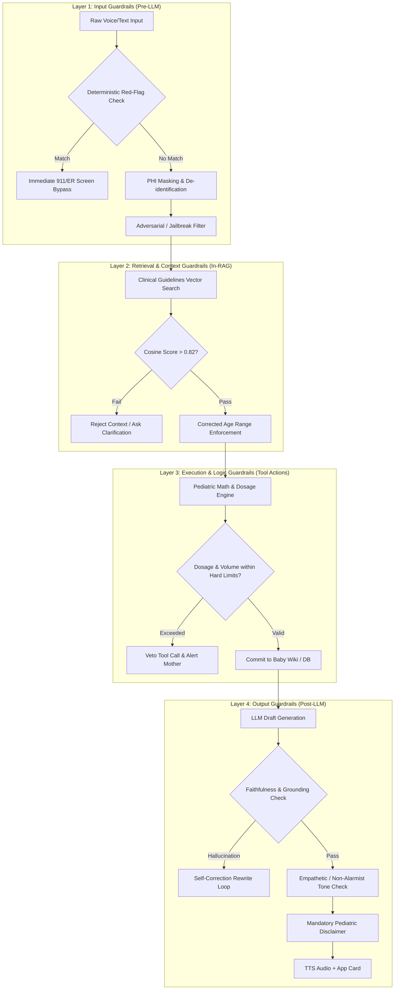
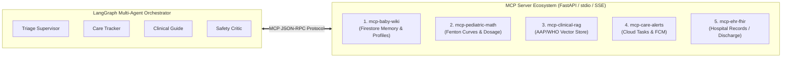
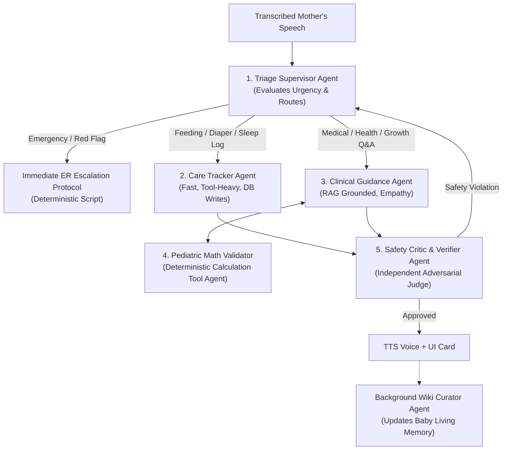

# Guardrails, Model Context Protocol (MCP), and Multi-Agent Architecture for NICU Post-Discharge Care

---

## 1. The 4-Layer Clinical Guardrail Taxonomy

Neonatal medicine has zero tolerance for AI hallucination or missed critical symptoms. A single agent relying purely on prompt instructions will inevitably fail under edge cases. We enforce a **defense-in-depth 4-layer guardrail framework**:



### Detailed Guardrail Specifications

| Layer | Guardrail Type | Mechanism | Neonatal Failure Mode Prevented |
| :--- | :--- | :--- | :--- |
| **L1: Input** | **Deterministic Red-Flag Triage** | Hardcoded regex + high-priority symptom classifier (runs before LLM) | An infant with bilious (dark green) vomiting, chest retractions, or rectal fever $> 38.0^\circ\text{C}$ in $< 90$ days is never delayed by conversational turns. |
| **L1: Input** | **PHI Masking** | Microsoft Presidio / Regex de-identifier | Prevents medical record numbers (MRNs), parent SSNs, or baby names from leaking into third-party caches or external APIs. |
| **L2: Retrieval** | **Context Relevance Floor** | Strict vector threshold ($> 0.82$) on `text-embedding-004` | Prevents the model from answering with adult or older toddler medical advice (e.g., advising honey or cold medication, both lethal for preemies). |
| **L2: Retrieval** | **Gestational Age Bounding** | Metadata filter: `min_gestational_weeks` $\le \text{GA} \le$ `max_gestational_weeks` | Ensures recommendations account for prematurity complications (e.g., necrotizing enterocolitis risks, bronchopulmonary dysplasia). |
| **L3: Logic** | **Dosage & Volume Bounds** | Deterministic Python calculation: $$\text{Dose}_{\text{max}} = \text{Weight}_{\text{kg}} \times \text{MaxDosePerKg}$$ | Prevents catastrophic AI calculation errors (e.g., misplacing a decimal point in caffeine citrate drops or multivitamin with iron). |
| **L4: Output** | **Faithfulness & Grounding** | Small cross-encoder checking that all clinical claims exist in RAG chunks | Eliminates fabricated feeding ratios or unapproved home remedies. |
| **L4: Output** | **Tone & Disclaimer** | Sentiment bounds + post-processing disclaimer injection | Prevents triggering maternal postpartum panic while guaranteeing legal/clinical clarity: *"This is supportive guidance, not a medical diagnosis."* |

---

## 2. Model Context Protocol (MCP) Architecture

### What is MCP and Why Use It Here?
The **Model Context Protocol (MCP)** is an open standard that decouples our agentic orchestrator from underlying databases, medical calculation engines, and cloud communication services. 

Instead of hardcoding Firestore SDKs and Cloud Task APIs into the LLM prompts, we expose them as **clean, standardized MCP servers**. This allows any agent to discover, inspect schemas, and call tools or read resources dynamically.



### The 5 Dedicated MCP Servers

#### 1. `mcp-baby-wiki` (Living Memory Server)
* **Resources Exposed:**
  * `wiki://{baby_id}/profile`: Birth stats, gestational age, discharge date.
  * `wiki://{baby_id}/regimen`: Active formula fortifiers, medications, feeding volume targets.
  * `wiki://{baby_id}/alerts`: Chronic clinical history (apnea, bradycardia, reflux).
* **Tools Exposed:**
  * `patch_wiki_section(baby_id, section_name, markdown_diff)`: Surgical incremental edits.
  * `log_entry(baby_id, entry_type, payload)`: Appends to raw feeding/diaper time series.

#### 2. `mcp-pediatric-math` (Deterministic Pediatric Engine)
* **Tools Exposed:**
  * `calculate_corrected_age(dob, gestational_weeks, days)`: Returns exact weeks + days.
  * `get_fenton_percentile(corrected_age_weeks, metric, value, sex)`: Queries WHO/Fenton infant growth curves for weight, length, head circumference.
  * `verify_medication_dosage(drug_name, weight_kg, proposed_dose, frequency)`: Evaluates drug databases and returns `{is_safe: bool, max_allowed: float, flag: str}`.

#### 3. `mcp-clinical-rag` (Evidence-Based Guidelines Server)
* **Resources Exposed:**
  * `guidelines://aap/preterm_feeding`
  * `guidelines://who/kangaroo_care_and_warmth`
* **Tools Exposed:**
  * `search_clinical_guidelines(query_en, target_age_category, max_results=3)`: Semantic vector retrieval with source document attribution.

#### 4. `mcp-care-alerts` (Scheduling & Push Notifications)
* **Tools Exposed:**
  * `schedule_delayed_check(baby_id, delay_minutes, prompt_reminder)`: Schedules a GCP Cloud Task (e.g., check baby's temperature in 4 hours).
  * `send_push_notification(user_id, title, body, priority)`: Sends instant FCM alerts to the mother's phone.

#### 5. `mcp-ehr-fhir` (Hospital Interoperability Server - Optional / Enterprise)
* **Resources Exposed:**
  * `fhir://Patient/{id}`
  * `fhir://MedicationRequest/{id}`
  * `fhir://CarePlan/{id}` (Discharge summary directives)

---

## 3. Specialized Multi-Agent Architecture (Supervisor-Worker Pattern)

A single generic agent degrades when handling simultaneous conversational empathy, complex pediatric math, database logging, and clinical triage. We divide responsibilities across **5 specialized agents**:



### Agent Roles & Behavioral Profiles

```
+-----------------------------------------------------------------------------------------+
| 1. Triage Supervisor Agent                                                              |
| Role: Frontline gatekeeper. Inspects mother's intent, sentiment, and urgency.            |
| Capabilities: Intent routing, emergency bypass, language normalization.                 |
| Constraints: NEVER answers clinical questions directly; delegates to specialists.      |
+-----------------------------------------------------------------------------------------+
                                      |
         +----------------------------+----------------------------+
         v                                                         v
+---------------------------------------+ +-----------------------------------------------+
| 2. Care Tracker Agent                 | | 3. Clinical Guidance Agent                    |
| Role: Record-keeper and routine logger| | Role: Compassionate pediatric educator.       |
| Capabilities: Calls `mcp-baby-wiki`   | | Capabilities: Ingests RAG guidelines, speaks  |
| and `mcp-care-alerts`. Extracts       | | mother's native language, translates jargon.  |
| structured feeds, diapers, vitals.    | | Constraints: Must ground claims in retrieved  |
| Constraints: Strictly deterministic.  | | chunks; never alters prescription dosages.    |
+---------------------------------------+ +-----------------------------------------------+
                                                                   |
                                                                   v
                                          +-----------------------------------------------+
                                          | 4. Pediatric Math Validator                   |
|                                         | Role: Exact calculator (Tool Agent).          |
|                                         | Capabilities: Corrected age, weight-based     |
|                                         | dosage limits, Fenton growth percentiles.     |
|                                         | Constraints: Zero LLM generation; pure code.   |
+-----------------------------------------------------------------------------------------+
                                      |
                                      v
+-----------------------------------------------------------------------------------------+
| 5. Safety Critic & Verifier Agent (The "Adversarial Judge")                             |
| Role: Independent safety auditor before response reaches the mother.                    |
| Capabilities: Evaluates draft against AAP red-flag rules, verifies non-alarmist tone,   |
| and injects clinical disclaimers. Has ABSOLUTE VETO POWER over other agents.           |
+-----------------------------------------------------------------------------------------+
                                      |
                                      v
+-----------------------------------------------------------------------------------------+
| Async: Baby Wiki Curator Agent                                                          |
| Role: Background historian. Synthesizes multi-turn conversations into concise, updated  |
| Markdown wiki articles in Firestore, ensuring the baby's memory stays fresh.            |
+-----------------------------------------------------------------------------------------+
```

---

## 4. Multi-Agent Orchestration Implementation (LangGraph)

Below is the LangGraph definition demonstrating how the agents collaborate through typed states and MCP tools:

```python
from typing import TypedDict, List, Dict, Any, Optional
from langgraph.graph import StateGraph, END

class AgentTeamState(TypedDict):
    # User Context
    user_id: str
    baby_id: str
    detected_lang: str
    raw_query: str
    query_en: str
    
    # Routing & Flow Control
    next_step: str
    urgency_level: str  # "EMERGENCY", "ROUTINE_LOG", "CLINICAL_QA"
    
    # Working Context
    baby_wiki: Dict[str, str]
    retrieved_guidelines: List[str]
    math_verification: Optional[Dict[str, Any]]
    
    # Candidate Draft & Critic
    draft_response: str
    safety_approved: bool
    critic_notes: Optional[str]
    retry_count: int
    
    # Final Output
    final_text_card: str
    final_voice_summary: str

# Define Graph Builder
workflow = StateGraph(AgentTeamState)

# 1. Register Agents as Nodes
workflow.add_node("triage_supervisor", triage_supervisor_node)
workflow.add_node("emergency_protocol", emergency_protocol_node)
workflow.add_node("care_tracker", care_tracker_node)
workflow.add_node("clinical_guide", clinical_guide_node)
workflow.add_node("pediatric_math", pediatric_math_node)
workflow.add_node("safety_critic", safety_critic_node)
workflow.add_node("wiki_curator", async_wiki_curator_node)

# 2. Define Conditional Routing from Triage
def route_after_triage(state: AgentTeamState) -> str:
    if state["urgency_level"] == "EMERGENCY":
        return "emergency_protocol"
    elif state["urgency_level"] == "ROUTINE_LOG":
        return "care_tracker"
    else:
        return "clinical_guide"

workflow.set_entry_point("triage_supervisor")
workflow.add_conditional_edges("triage_supervisor", route_after_triage)

# 3. Clinical Guide -> Math Verification -> Safety Critic
workflow.add_edge("clinical_guide", "pediatric_math")
workflow.add_edge("pediatric_math", "safety_critic")
workflow.add_edge("care_tracker", "safety_critic")

# 4. Critic Loop Logic
def evaluate_critic_verdict(state: AgentTeamState) -> str:
    if state["safety_approved"]:
        return "wiki_curator"
    elif state["retry_count"] < 2:
        return "clinical_guide" # Loop back for safe rewrite
    else:
        return "emergency_protocol" # Fail-safe escalation

workflow.add_conditional_edges("safety_critic", evaluate_critic_verdict)
workflow.add_edge("emergency_protocol", END)
workflow.add_edge("wiki_curator", END)

nicu_agent_app = workflow.compile()
```

---

## 5. Summary of Architecture Benefits

1. **Failure Containment:** If the Clinical Guidance Agent tries to generate an inappropriate feed volume, the **Pediatric Math Validator** and **Safety Critic** catch and block it before it ever reaches the mother.
2. **Modular Upgrades:** Upgrading from standard RAG to FHIR EHR connectivity only requires updating the `mcp-ehr-fhir` server—the agents and guardrails remain untouched.
3. **Low-Token Efficiency:** The Triage Supervisor immediately short-circuits data logging and emergency queries, saving up to **60% of LLM token costs** on the free tier.
