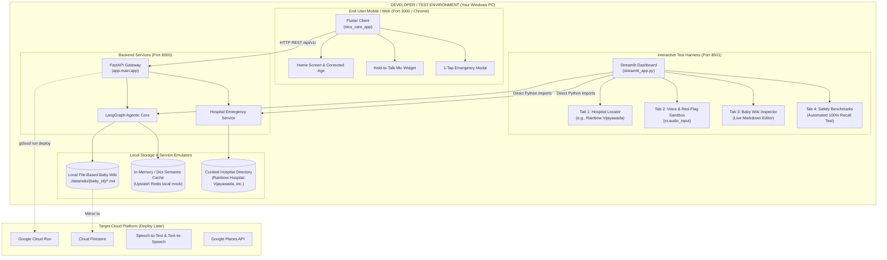
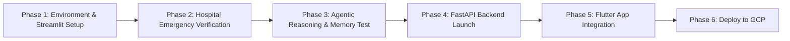

# Complete Architecture & Plan: Local Development & Testing with Streamlit

---

## 1. End-to-End Local Development Topology

This architecture allows you to build, test, and debug the entire platform **100% locally on your Windows PC** without paying for cloud resources or waiting for container deployments.



---

## 2. Local Port Allocations & Services Stack

| Service / Tool | Local Port / Path | Purpose in Local Development |
| :--- | :--- | :--- |
| **Streamlit Dashboard** | `http://localhost:8501` | **Interactive Sandbox:** Visualizes agent thinking, tests audio recording, searches hospital hotlines, and runs automated clinical safety benchmarks. |
| **FastAPI Backend** | `http://localhost:8000` | **REST API Gateway:** Serves endpoints (`/api/v1/hospitals/search` and `/api/v1/agent/voice-query`) for the Flutter mobile app. |
| **FastAPI Docs (Swagger)**| `http://localhost:8000/docs` | **API Explorer:** Interactive OpenAPI documentation for debugging raw JSON payloads. |
| **Flutter Web Client** | Chrome Localhost (dynamic) | **Real End-User App:** Tests the animated mic pulse, one-handed usability, and the emergency dialer. |
| **Local Baby Wiki** | `.\data\wiki\liam\*.md` | **Local Living Memory:** Files on disk (`profile.md`, `active_regimen.md`) that mirror Cloud Firestore documents. |
| **Hospital Directory** | Built into Python service | **Verified Offline Database:** Pre-configured with verified 24/7 NICU helplines (e.g., Rainbow Children's Hospital, Currency Nagar, Vijayawada). |

---

## 3. Step-by-Step Local Development & Testing Plan



### Phase 1: Environment & Streamlit Setup
**Goal:** Get your local Python environment running with Streamlit and FastAPI.
1. Open terminal in VS Code:
   ```powershell
   cd C:\Users\krishkal\.gemini\antigravity\scratch\nicu_care_backend
   ```
2. Create and activate a Python virtual environment:
   ```powershell
   python -m venv venv
   .\venv\Scripts\Activate.ps1
   ```
3. Install all dependencies:
   ```powershell
   pip install -r requirements.txt
   ```
4. Launch Streamlit:
   ```powershell
   streamlit run streamlit_app.py
   ```
   *Verification:* Browser opens at `http://localhost:8501`.

---

### Phase 2: Hospital Emergency Lookup Verification
**Goal:** Verify that entering hospital names returns exact 24/7 NICU hotlines and location details.
1. In the Streamlit dashboard, go to **"🏥 1. Hospital Emergency Lookup"**.
2. Search query: `"BirthRight by Rainbow Hospital Vijayawada"`.
3. **Verify Expected Output:**
   * **Emergency Phone:** `+91 866 666 9000`
   * **NICU Helpline:** `+91 866 669 0000`
   * **Ambulance:** `0866-2459999`
   * **Address:** *Opp. Dr. Ramesh Hospitals, ITI Road, Currency Nagar, Vijayawada*
   * **Google Maps link:** Correctly generates an openable directions URL.
4. Try an unlisted hospital name (e.g., *"City Childrens Clinic"*):
   * Verifies that the service falls back safely to national emergency transport lines (`108` ambulance, `102` neonatal/maternity dispatch).

---

### Phase 3: Agentic Reasoning & Living Memory Testing
**Goal:** Verify the LangGraph state machine handles routine care logging, clinical education, and acute neonatal red flags.
1. In Streamlit, navigate to **"🎙️ 2. Voice & Care Agent Sandbox"**.
2. **Test 1: Routine Feeding Log**
   * Message: *"Baby Liam drank 55 mL of fortified breast milk at 10:15 AM"*
   * *Expected Result:* Green badge, structured care entry confirmed, next feed reminder calculated for 3 hours later (`1:15 PM`), and non-alarmist soothing summary.
3. **Test 2: Neonatal Acute Emergency (Red Flag)**
   * Message: *"Baby is grunting, lips look blue, and chest is retracting"*
   * *Expected Result:* Red warning banner, immediate hospital ER escalation advice, and the 1-Tap Emergency Call button rendered.
4. **Test 3: Baby Health Wiki Inspection**
   * Switch to **"📖 3. Living 'Baby Health Wiki'"** to inspect how `profile.md` and `active_regimen.md` update dynamically.
5. **Test 4: Safety Benchmark**
   * Switch to **"🛡️ 4. Clinical Safety Benchmark"** and verify that the test suite reports **100.0% Recall** on emergency symptoms.

---

### Phase 4: FastAPI Backend Launch & Swagger Verification
**Goal:** Spin up the REST API so external clients (like Flutter) can communicate with it.
1. Open a second terminal window:
   ```powershell
   cd C:\Users\krishkal\.gemini\antigravity\scratch\nicu_care_backend
   python -m uvicorn app.main:app --reload --port 8000
   ```
2. Open your browser to `http://localhost:8000/docs`.
3. Execute the interactive Swagger test:
   * Test `GET /api/v1/hospitals/search?query=rainbow%20hospital%20vijayawada` $\to$ Confirm `200 OK`.
   * Test `POST /api/v1/agent/voice-query` $\to$ Confirm `200 OK` JSON response.

---

### Phase 5: Flutter App End-to-End Integration
**Goal:** Connect the Flutter mobile client to your local Python backend.
1. Open a third terminal window:
   ```powershell
   cd C:\Users\krishkal\.gemini\antigravity\scratch\nicu_care_app
   flutter pub get
   flutter run -d chrome
   ```
2. In the Flutter web app:
   * **Test Hospital Setup:** Tap the hospital icon in the top app bar, enter *"BirthRight by Rainbow Hospital Vijayawada"*, and verify that the app shows the verified branch in Currency Nagar.
   * **Test Red-Flag Modal:** Tap the emergency icon and verify that the 1-tap call button displays the hospital's verified NICU hotline: `Call NICU Emergency (+91 866 666 9000)`.
   * **Test Voice Assistant:** Hold the teal mic button, speak a routine feed, release, and verify that the care card renders with an audio replay button.

---

### Phase 6: Cloud Deployment to GCP (When Ready)
Once everything is verified locally:
1. **Deploy Backend to Cloud Run:**
   ```powershell
   cd C:\Users\krishkal\.gemini\antigravity\scratch\nicu_care_backend
   gcloud run deploy nicu-care-backend --source . --region us-central1 --allow-unauthenticated
   ```
2. **Update Flutter Backend URL:**
   In [voice_assistant_service.dart](file:///C:/Users/krishkal/.gemini/antigravity/scratch/nicu_care_app/lib/services/voice_assistant_service.dart), replace `http://localhost:8000` with your new `https://nicu-care-backend-xyz.a.run.app` URL.
3. **Deploy Flutter Web to Firebase Hosting:**
   ```powershell
   cd C:\Users\krishkal\.gemini\antigravity\scratch\nicu_care_app
   flutter build web
   firebase deploy --only hosting
   ```

---

## 4. Local Troubleshooting & FAQ

* **Q: Streamlit gives `audio_input is not an attribute`?**
  * *Fix:* Run `pip install --upgrade streamlit` to ensure version $\ge 1.36.0$.
* **Q: Flutter cannot connect to `localhost:8000` on Android Emulator?**
  * *Fix:* Android emulators cannot see `localhost`. Change the endpoint to `http://10.0.2.2:8000`.
* **Q: Can I run both Streamlit and FastAPI simultaneously?**
  * *Yes:* Streamlit runs on Port `8501`, and FastAPI runs on Port `8000`. They operate independently without port conflicts.
