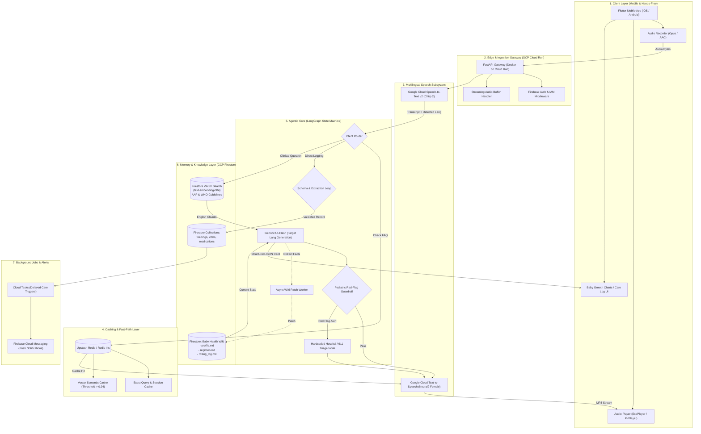
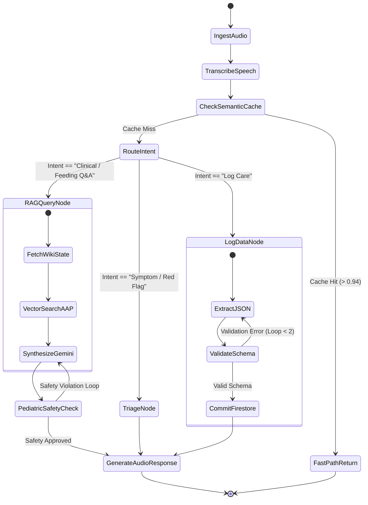

# Complete System Architecture: Multilingual Voice-Enabled Agentic Post-NICU Baby Care Platform

## 1. Executive Summary & Architectural Principles

This platform supports mothers and caregivers managing fragile, discharged preterm or neonatal intensive care unit (NICU) infants. The system is engineered around four core tenets:

1. **Free-Tier Optimized Serverless Infrastructure:** Leverages Google Cloud Run, Google AI Studio (Gemini 2.5 Flash), Firestore, and Upstash Redis to achieve zero idle infrastructure cost and handle up to tens of thousands of requests monthly without exceeding GCP free tier limits.
2. **Empathetic Multimodal Interaction:** Allows mothers with full hands to speak in their native tongue (Spanish, Hindi, English, Tagalog, etc.) and receive both a clear, formatted visual card and a soothing audio response.
3. **Graph-Engineered Determinism & Clinical Safety:** Uses **LangGraph** to enforce explicit state-machine routing, API call short-circuiting, schema validation loops, and clinical safety guardrails (100% recall on neonatal red-flag symptoms).
4. **Structured Living Memory (The Baby Wiki):** Replaces sprawling, token-expensive chat histories with a continuously updated, Markdown-based "Baby Health Wiki" stored in Firestore.

---

## 2. End-to-End System Blueprint



---

## 3. Component Deep Dive

### 3.1. Client Layer (Flutter Mobile App)
* **Framework:** Flutter 3.x for native compilation to iOS and Android.
* **Audio Capture:** Uses the `record` package to capture single-channel 16 kHz AAC/Opus audio. Includes client-side Voice Activity Detection (VAD) to prevent transmitting dead silence, saving STT quotas.
* **Audio Playback:** Uses `audioplayers` for immediate, low-latency streaming of the returned voice response.
* **Offline-First Persistence:** Leverages Cloud Firestore offline cache so logs can be entered with zero network connection and synced automatically upon reconnection.

### 3.2. Speech Subsystem & Cross-Lingual Translation
* **Speech-to-Text (STT):** Google Cloud Speech-to-Text v2 powered by the **Chirp 2** foundation model. It accepts raw audio and performs automatic multi-language recognition across target dialects (e.g., `en-US`, `es-US`, `hi-IN`, `tl-PH`, `ar-XA`).
* **Cross-Lingual Normalization:** Authoritative neonatal literature is primarily in English. When $L_{\text{user}} \neq \text{English}$, the graph creates a translated English query $Q_{\text{en}}$ strictly for semantic cache and vector search operations, preventing vocabulary degradation.
* **Text-to-Speech (TTS):** Google Cloud Text-to-Speech with **Neural2** voices configured with high-warmth pitch and a relaxed speaking rate (0.92–0.95x) to deliver empathetic, easily digestible maternal guidance.

### 3.3. Conversational Memory: The "Baby Health Wiki" Engine
Rather than passing an ever-expanding chat history to Gemini (which causes context drift, token waste, and high latency), the agent maintains a **Living Wiki** in Firestore under `/users/{uid}/babies/{babyId}/wiki/`:

```
Wiki Document Hierarchy:
├── profile.md
│   ├── Gestational Age at Birth (e.g., 28w 3d)
│   ├── Chronological Age vs Corrected Age calculation
│   └── Discharge Weight, Head Circumference, Length
├── active_regimen.md
│   ├── Current Caloric Fortification (e.g., 24 kcal/oz HMF)
│   ├── Prescribed Meds (e.g., Caffeine Citrate, Multivitamin with Iron)
│   └── Minimum 24h intake target (e.g., 420 mL/day)
├── clinical_alerts.md
│   ├── History of Bronchopulmonary Dysplasia (BPD)
│   ├── Grade 1 Intraventricular Hemorrhage (IVH) follow-up
│   └── Stoma / Surgical scar monitoring
└── rolling_log_summary.md
    └── Compressed summary of the past 48 hours (Feeds, Stools, Vitals)
```

**Wiki Patch Workflow:** After a conversational session completes, an asynchronous worker node analyzes the conversation. If new durable clinical parameters are identified (e.g., *"The pediatrician told us to stop caffeine drops"*), it invokes a surgical Markdown update to `active_regimen.md`.

---

## 4. LangGraph State Machine & Loop Engineering

The core decision loop is managed using **LangGraph**. The state graph minimizes external API calls and enforces rigorous loops for schema correction and clinical safety.



### 4.1. LangGraph State Schema (`NICUState`)
```python
from typing import TypedDict, Optional, List, Dict, Any

class NICUState(TypedDict):
    # Session metadata
    user_id: str
    baby_id: str
    session_id: str
    
    # Audio & Multilingual
    audio_input_bytes: Optional[bytes]
    detected_language: str              # e.g., "es-US", "en-US", "hi-IN"
    user_query_original: str           # Original transcribed text
    user_query_normalized_en: str      # English query for RAG
    
    # Caching & Routing
    intent: str                        # "LOG_DATA", "RED_FLAG", "CLINICAL_QA", "PROFILE"
    is_cache_hit: bool
    cached_response: Optional[Dict[str, Any]]
    
    # Memory & Context
    baby_wiki_context: str             # Current compiled Markdown wiki
    retrieved_clinical_docs: List[str] # Vector search chunks from AAP/WHO
    
    # Outputs & Validation
    generated_text_card: str           # Formatted screen card for app
    generated_voice_script: str        # 2-sentence soothing audio script
    safety_violations: List[str]
    loop_retry_count: int
    audio_output_bytes: Optional[bytes]
```

### 4.2. Loop Engineering Mechanisms
1. **Self-Correction Schema Loop:**
   * When parsing unformatted speech into structured feeding or medication entries (e.g., *"Gave him half an ounce of Neosure mixed with breastmilk at ten fifteen"*), a Pydantic schema validates:
     $$\text{Volume} > 0 \land \text{Unit} \in \{\text{mL}, \text{oz}\} \land \text{Timestamp} \le \text{Now}$$
   * If validation fails (e.g., negative volume or ambiguous unit), the graph re-invokes the extraction node with the specific validation error message (maximum 2 retries) before prompting the mother for clarification.
2. **Pediatric Red-Flag Guardrail Loop:**
   * Outputs pass through a deterministic safety filter checking against neonatal danger signs:
     * Rectal temperature $< 36.5^\circ\text{C}$ ($97.7^\circ\text{F}$) or $> 38.0^\circ\text{C}$ ($100.4^\circ\text{F}$) in infants $< 3$ months.
     * Signs of respiratory distress (chest wall retractions, grunting, nasal flaring).
     * Bilious (green) emesis or no wet diapers in 12 hours.
   * If any red flag is detected, the graph loops back and substitutes the conversational response with the **Urgent Clinician Escalation Protocol**, outputting immediate directions to call the pediatrician or emergency room.

---

## 5. Storage, Vector Search & Caching Design

### 5.1. Upstash Redis (Semantic Cache & Rate Limiting)
* **Exact Cache:** Hashes normalized $(Q_{\text{en}}, \text{baby\_id})$ to check for recent identical questions within 1 hour.
* **Semantic Vector Cache:** Uses Redis vector similarity search against cached user queries. If cosine similarity $> 0.94$, the pre-generated response in the mother's target language is returned immediately. This reduces Gemini Flash API calls by approximately 35–45%.

### 5.2. Cloud Firestore (Operational Data & Vector Store)
* **Vector Search Index:** Utilizes Firestore's native vector search extension indexed with Google's `text-embedding-004` (768 dimensions).
* **Document Collections:**
  * `users/{uid}`: Account settings, preferred language, emergency contact numbers.
  * `users/{uid}/babies/{babyId}`: Demographic data, discharge date, birth GA.
  * `users/{uid}/babies/{babyId}/feedings`: Granular real-time feed records.
  * `users/{uid}/babies/{babyId}/growth_logs`: Weight, length, and head circumference mapped against Fenton Preterm Growth Charts.

---

## 6. Security, Privacy & HIPAA Compliance on GCP

Because this system manages Protected Health Information (PHI) of infants, the following architecture controls are enforced:

> [!IMPORTANT]
> Google Cloud provides a **HIPAA Business Associate Agreement (BAA)** covering Cloud Run, Firestore, Cloud Storage, Cloud Key Management Service (KMS), and Cloud Logging.

1. **BAA Execution:** Sign the GCP BAA directly within the Google Cloud Console Compliance Center.
2. **Data Minimization in Caching:** The Redis semantic cache **only** caches general pediatric guidance (e.g., sterilizing pump parts, warming milk). Specific baby logs or identifying details (names, MRNs, exact dates of birth) are **never** indexed in the semantic cache.
3. **Data at Rest & in Transit:** All traffic is strictly TLS 1.3. Firestore documents are encrypted at rest with Google-managed or Customer-Managed Encryption Keys (CMEK) via Cloud KMS.
4. **Cloud Audit Logs:** All data read and write operations are routed through Cloud Audit Logs (Data Access logs) stored in a secure, immutable log sink.

---

## 7. Free-Tier Cost Optimization & Scalability Matrix

This architecture is deliberately designed so that an early-stage deployment or pilot operates at **\$0/month**:

| Component | Provider / Service | Free-Tier Allowance | Consumption Rate & Conservation Tactics |
| :--- | :--- | :--- | :--- |
| **App Compute** | GCP Cloud Run | 2,000,000 requests/mo<br>360,000 GB-sec CPU | Set minimum instances to 0. Scales to zero when idle; cold starts on Python FastAPI are $\sim 400\text{ ms}$. |
| **LLM Inference** | Google AI Studio (Gemini 2.5 Flash) | 15 RPM<br>1,500 Requests/Day | Short prompts ($< 1,000$ tokens) via the Baby Wiki keep daily token consumption $< 100\text{k}$ tokens. |
| **Embeddings** | `text-embedding-004` | 1,500 Requests/Day free | Guideline vectors are embedded once in batch; runtime embeddings are single-query only. |
| **Database** | GCP Cloud Firestore | 1 GiB storage<br>50,000 reads/day<br>20,000 writes/day | Firestore offline cache on mobile satisfies local queries without triggering network reads. |
| **Semantic Cache** | Upstash Redis | 10,000 commands/day | Serverless REST connection requires no VPC, reducing GCP networking overhead. |
| **Speech-to-Text** | GCP STT v2 (Chirp 2) | 60 minutes/month free | Client-side Voice Activity Detection strips silence so only spoken duration is billed. |
| **Text-to-Speech** | GCP TTS (Neural2) | 1,000,000 characters/mo | Agent produces a brief 2-sentence spoken summary ($\sim 150$ chars), saving TTS quota. |
| **Notifications** | Firebase Cloud Messaging | 100% Free | Unlimited push notifications for medication, feed, and appointment reminders. |

---

## 8. Continuous Evaluation Framework (Ragas & Safety Triad)

To maintain pediatric safety and prevent conversational degradation, the application is monitored against these metrics in automated CI/CD integration pipelines:

```
               +------------------------------------------------+
               |          Neonatal Safety Benchmarks            |
               +------------------------------------------------+
               |  Red-Flag Symptom Recall:          100.0%      |
               |  Ragas Faithfulness:               > 0.95      |
               |  Ragas Answer Relevance:           > 0.90      |
               |  Pediatric Guideline Groundedness: > 0.98      |
               |  Cross-Lingual Semantic Precision: > 0.92      |
               |  Average P95 Latency (Audio -> TTS):< 2.4s     |
               +------------------------------------------------+
```

* **Synthetic Clinical Test Suite:** A set of 200 synthetic maternal queries (spanning emergency scenarios, benign feeding inquiries, and complex medication math) runs against every new prompt and LangGraph iteration.
* **Hard Assertion on Red Flags:** Any code commit where the agent fails to recommend emergency care for an infant with a rectal temperature $> 38.0^\circ\text{C}$ or breathing retractions automatically breaks the CI build.
