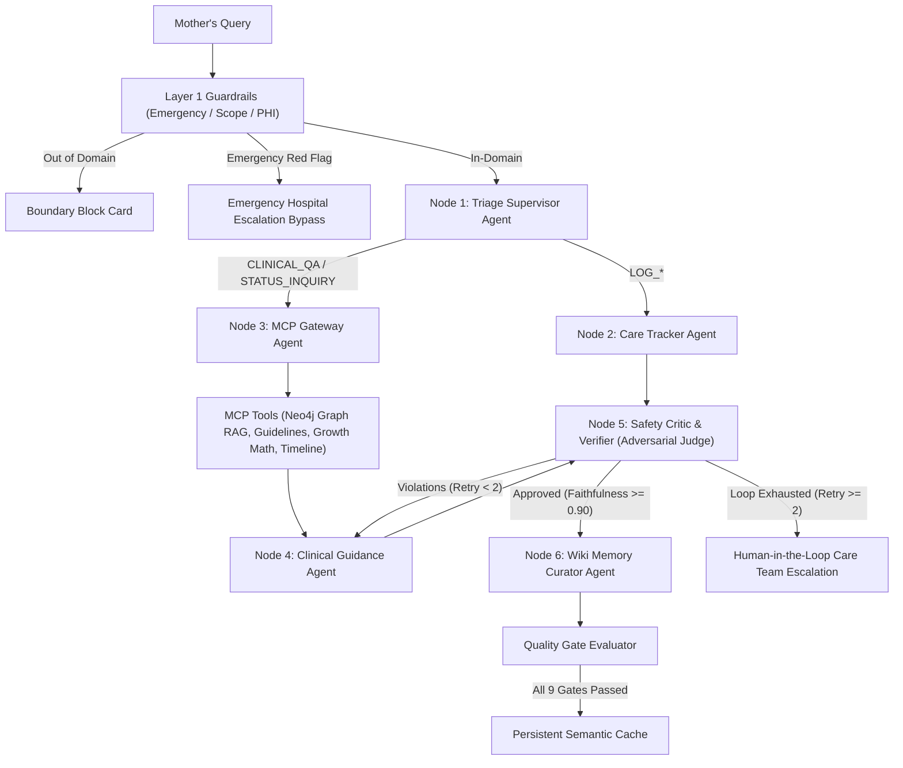

# 🩺 NICU HomeCare AI — System Skills, Agent Roles & Configuration Architecture

This specification documents the multi-agent orchestration, strict domain boundaries, Model Context Protocol (MCP) tool bindings, Neo4j Aura Graph RAG integration, and quantitative quality gates governing the NICU Post-Discharge Clinical Guardian.

---

## 1. Application Scope Boundaries & Layer 1 Input Guardrails

The system enforces a zero-tolerance boundary: queries outside the neonatal and post-discharge domain are blocked at Layer 1 before any LLM reasoning, vector lookup, or tool execution.

### In-Domain Whitelist Categories
1. **Preterm Infant Care:** Gestational age, corrected age, discharge criteria, hospital follow-ups.
2. **Neonatal Nutrition:** Fortified breast milk, formula preparation, feeding targets (150–180 mL/kg/day), paladai feeding, latching, reflux, burping.
3. **Kangaroo Mother Care (KMC):** Skin-to-skin positioning (frog-like, clear airway), wrapping, duration targets (minimum 60 min/session, 2–4 hr/day).
4. **Growth Monitoring:** Weight velocity (~15–20 g/kg/day), Fenton 2013 growth curves, length, head circumference.
5. **Safe Sleep Hygiene:** AAP safe sleep (back to sleep, firm flat crib mattress, room-sharing without bed-sharing).
6. **Equipment & Sterilization:** AAP/CDC 5-step bottle and pump cleaning, boiling, safe breast milk storage.
7. **Elimination & Hydration:** Diaper monitoring (minimum 6 wet diapers/day), stool transition, constipation, urine urates.
8. **Acute Danger Signs:** Neonatal hypothermia (< 36.5°C), fever (>= 38.0°C), apnea (> 20s), bilious green vomit, chest retractions, cyanosis, lethargy.
9. **Medications & Supplements:** Elemental iron drops, Vitamin D3, caffeine citrate, administration protocols.
10. **Maternal Postpartum Health:** Lactation support, engorgement, mastitis signs, emotional wellbeing.

### Blocked Out-of-Domain Categories
* Financial / Crypto / Stock trading
* Software coding / Programming / General IT
* Politics / Elections / Government
* Sports / Gaming / Entertainment
* Adult general medical conditions unrelated to postpartum/infant care
* General knowledge trivia / Academic essays

---

## 2. Multi-Agent Team: Roles, Skills & Tool Mappings



### Agent Skill Matrix

| Agent | Core Skill | System Prompt | Allowed MCP Tools / APIs |
| :--- | :--- | :--- | :--- |
| **Triage Supervisor** | Urgency scanning, NLU disambiguation, boundary enforcement | `TRIAGE_SUPERVISOR_PROMPT` | Jev Decision Engine, QueryUnderstandingEngine |
| **Care Tracker** | Deterministic care logging & cumulative calculation | `CARE_TRACKER_PROMPT` | `TimelineService`, `CareLogService` |
| **MCP Gateway** | Safe tool dispatch & parameter schema validation | `MCP_GATEWAY_PROMPT` | `mcp_growth_intelligence`, `mcp_care_timeline_inspector`, `mcp_pediatric_calculator`, `mcp_guideline_retriever`, `mcp_graph_rag_traversal`, `mcp_hospital_emergency_locator` |
| **Clinical Guide** | Evidence-grounded synthesis from chunks & graph paths | `CLINICAL_GUIDE_PROMPT` | `ClinicalRAGService`, `HospitalEmergencyService` |
| **Pediatric Math** | Fenton growth velocity, fluid calculations, corrected age | `PEDIATRIC_MATH_PROMPT` | `PediatricMathService` |
| **Safety Critic** | Adversarial veto, Claim Verification, RAGAS loop control | `SAFETY_CRITIC_PROMPT` | `ClaimVerificationEngine`, `OutputGuardrails`, `RAGASEvaluator`, `hitl_service` |
| **Wiki Curator** | Long-term memory compression, patch deduplication | `WIKI_CURATOR_PROMPT` | `WikiService`, `LongTermMemoryManager` |

---

## 3. Connected Neo4j Aura Cloud Property Graph

The system connects live to the Neo4j Aura cloud instance (`neo4j+ssc://b3ba6fd2.databases.neo4j.io`) containing 55 clinical nodes across 18 clinical labels:

```
Nodes (55 total):
  - Symptom (5), Diagnosis (3), Regimen (6), Contraindication (4), Facility (4)
  - Baby (2), Mother (2), DischargePlan (2), FeedingPlan (2), KMCPlan (2)
  - MedicationSchedule (2), Appointment (2), ClinicalGuideline (3), CareInstruction (3)
  - ScheduledTask (5), Reminder (1), WarningSign (6), EscalationRule (1)

Relationships (42 total):
  - INDICATES, ENFORCES_CONTRAINDICATION, ESCALATES_TO, ASSOCIATED_WITH, PREVENTS
  - CARED_BY, HAS_DISCHARGE_PLAN, HAS_SCHEDULED_TASK, CONTAINS_PLAN, CONTAINS_SCHEDULE
  - HAS_APPOINTMENT, SUPPORTED_BY, RECOMMENDS, TRIGGERS_REMINDER, REQUIRES_ESCALATION
```

### Traversal Protocol:
1. Matches clinical symptoms (e.g. green vomit, apnea, cyanosis, chest retractions).
2. Traverses multi-hop edges: `(Symptom) -> [:INDICATES] -> (Diagnosis) -> [:ENFORCES_CONTRAINDICATION] -> (Contraindication)`.
3. Attaches verified contraindications directly to top retrieved chunks before LLM synthesis.

---

## 4. Strict 9-Gate Quality Caching Protocol

Responses are only cached in in-memory semantic cache and Redis fallback if **ALL 9 quality criteria** are met:

1. **Non-Emergency:** `is_emergency == False` (emergency advice is dynamic).
2. **In-Domain:** `intent != "OUT_OF_DOMAIN"`.
3. **Non-Transactional:** `not intent.startswith("LOG_")` (never cache care logs).
4. **Safety Approved:** `safety_approved == True` (cleared by Safety Critic).
5. **Output Guardrails Passed:** `output_guardrail_passed == True` (zero banned advice).
6. **No HITL Escalation:** `requires_hitl == False` (only clinician-approved answers).
7. **RAGAS Faithfulness:** `faithfulness >= 0.90` (strictly grounded in evidence).
8. **Harm Prevention:** `harm_prevention_score == 1.00` (zero tolerance).
9. **Answer Relevance:** `answer_relevance >= 0.80` (directly answers query).

---

## 5. Separated Structured Discharge Plan vs. General Clinical Knowledge

To avoid conflating general guidelines with patient-specific prescriptions:
* **General Guidelines (ChromaDB & RAG):** Contain approved pediatric literature organized across the 12 clinical domains.
* **Structured Baby Discharge Plan (`BabyDischargePlan`):** Stored as typed clinical entities containing `feeding_plan`, `medications`, `kmc_plan`, `follow_up_appointments`, and `clinician_approved` flag.
